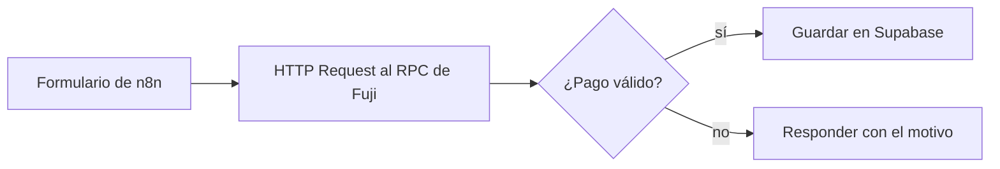

<!--
  Plantilla de README para el proyecto de tu equipo en Nodo Cero.
  Cómo usarla: copiala a la raíz del repo de tu proyecto con el nombre README.md, reemplazá lo que está entre corchetes
  y borrá las secciones que no usen (y este comentario). Sin correos, teléfonos, claves ni credenciales.
-->

# [Nombre del proyecto]

> [Una frase: qué hace y para quién.]

Proyecto creado en **Nodo Cero – Hackathon n8n Bolivia** (sábado 21 de noviembre de 2026), la hackathon de la comunidad n8n en Bolivia, enfocada en mujeres, de la mano de Women Techmakers Santa Cruz.
Ficha en la vitrina: [nodo-cero-bo/proyectos#[número]](https://github.com/nodo-cero-bo/proyectos/issues/[número])

<!-- Para la captura: en n8n, acomodá el canvas, ocultá datos personales y guardá la imagen como captura.png en el repo. -->

## El problema

[Qué pasa hoy, a quién le pasa y por qué importa. Dos o tres frases, con un ejemplo concreto.]

## La solución

[Qué hace el proyecto para resolverlo. Contalo como se lo contarías a alguien que no programa.]

## Cómo funciona el flujo

<!-- Reemplazá el diagrama por el de tu flujo. GitHub dibuja los bloques mermaid por su cuenta. -->

1. **[Disparador]**: [qué lo inicia: un formulario, un webhook, un horario, un mensaje de chat].
2. **[Paso clave]**: [qué hace y por qué lo resolvieron así].
3. **[Decisión]**: [qué se revisa y qué pasa en cada caso].
4. **[Salida]**: [qué recibe la persona que lo usa].

## Tecnologías

| Tecnología | Para qué la usamos |
|---|---|
| n8n | [el flujo principal: disparador, pasos y respuesta] |
| [IA: modelo o agente] | [por ejemplo, clasificar mensajes o responder preguntas] |
| [Supabase] | [por ejemplo, guardar registros o buscar en documentos] |
| [Clerk] | [por ejemplo, iniciar sesión y proteger la API] |
| [Avalanche Fuji] | [por ejemplo, verificar pagos o leer eventos de un contrato] |

## Cómo probarlo

### Qué necesitás

- Una cuenta de n8n: [n8n Cloud](https://app.n8n.cloud/register) o una instalación propia (probado con n8n [versión]).
- [Cuenta y credencial que pide cada servicio, con el tipo exacto de credencial de n8n. Por ejemplo: Supabase, credencial «Supabase API» con la URL del proyecto y la clave de servicio.]

### Pasos

1. Importá `workflow.json` en n8n: abrí un workflow nuevo y, en el menú del workflow, elegí **Import from File**. También podés copiar el JSON y pegarlo en el canvas con Ctrl + V.
2. Abrí cada nodo marcado en rojo y elegí o creá la credencial que pide.
3. [Cómo dispararlo: por ejemplo, abrí la URL de prueba del formulario y mandá un hash de Fuji.]
4. [Qué tendrías que ver: por ejemplo, la página final dice «Pago verificado» y aparece una fila nueva en Supabase.]

> Antes de publicar el JSON, revisalo: incluye el nombre de tus credenciales y, si pegaste un comando cURL en un HTTP Request, puede traer encabezados con claves.

## Transacción en Fuji

<!-- Borrá esta sección si no usaron Avalanche. -->

- Red: Avalanche Fuji C-Chain (chainId 43113)
- Transacción de prueba: [`0x...`](https://build.avax.network/explorer/fuji/c-chain/tx/0x...)

## Lo que sigue

- [Una mejora que quieren hacer.]
- [Otra idea para seguir construyendo.]

## Equipo

<!-- Si quieren aparecer: nombre, usuario de GitHub o perfil profesional. Sin correos ni teléfonos. -->

- [Nombre]: [qué hizo en el proyecto]
- [Nombre]: [qué hizo en el proyecto]

## Licencia

<!-- Elegí una licencia para tu código y dejala en un archivo LICENSE. Por ejemplo MIT, como los workflows de Nodo Cero: https://choosealicense.com/licenses/mit/ -->

Este proyecto está bajo la licencia [nombre de la licencia]: mirá el archivo [LICENSE](LICENSE).

n8n, Supabase, Clerk, Avalanche y los demás nombres son marcas de sus dueños.
