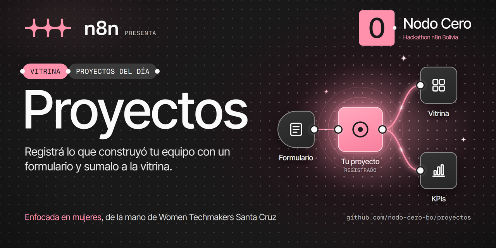

<p align="center">
  
</p>

<p align="center">
  <a href="https://nodo-cero-bo.github.io">Página</a> ·
  <a href="https://github.com/nodo-cero-bo/workflows">Workflows</a> ·
  <a href="https://github.com/nodo-cero-bo/guias">Guías</a> ·
  <a href="https://github.com/nodo-cero-bo/proyectos/issues/new?template=proyecto.yml"><b>Registrá tu proyecto</b></a>
</p>

# Proyectos de Nodo Cero

La vitrina de lo que construyen los equipos en **Nodo Cero – Hackathon n8n Bolivia**: la hackathon de la comunidad n8n en Bolivia, enfocada en mujeres, de la mano de Women Techmakers Santa Cruz. Sábado 21 de noviembre de 2026, en el Centro de Educación Ambiental (CEA) de Santa Cruz de la Sierra.

Cada proyecto es un issue con su ficha: qué hace, con qué tecnologías y dónde verlo. La lista de abajo se arma sola a partir de esas fichas.

## Registrá tu proyecto en 3 pasos

1. Entrá a **[Registrá tu proyecto](https://github.com/nodo-cero-bo/proyectos/issues/new?template=proyecto.yml)**. Necesitás una cuenta de GitHub; si no tenés, [creala gratis](https://github.com/signup).
2. Completá el formulario: nombre del proyecto y del equipo, qué hace y qué tecnologías usaron. Si querés, sumá el enlace al repo o al video y el hash de una transacción en Fuji.
3. Envialo con el botón verde del final. Con una persona por equipo alcanza.

## Qué pasa después

- El issue recibe la etiqueta `proyecto` y una por cada tecnología que marcaron: `n8n`, `ia`, `supabase`, `clerk` o `avalanche-fuji`.
- En un par de minutos el proyecto aparece en la lista de abajo, con su enlace y, si lo informaron, la transacción en el explorador de Fuji.
- Si algo cambia, editá el issue: la ficha y la lista se actualizan solas.
- Para documentar el proyecto en su propio repo, copien [PLANTILLA_README.md](PLANTILLA_README.md): problema, solución, cómo funciona el flujo, tecnologías, cómo probarlo y equipo.
- Pueden seguir construyendo después del evento y actualizar su ficha cuando quieran.

## Proyectos registrados

<!-- vitrina:inicio -->

Todavía no hay proyectos registrados. [Registrá el de tu equipo](https://github.com/nodo-cero-bo/proyectos/issues/new?template=proyecto.yml).

<!-- vitrina:fin -->

> La lista la arma el workflow de GitHub Actions [Vitrina](.github/workflows/vitrina.yml) con los issues abiertos que tienen la etiqueta `proyecto`. Si la automatización estuviera apagada, se completa a mano con el mismo formato, entre las marcas `vitrina:inicio` y `vitrina:fin`.

## Cuidá tus datos

- Todo lo que se publica acá es público.
- No pongas correos, teléfonos, claves privadas, frases semilla ni credenciales de n8n, de Supabase o de Clerk.
- El hash de una transacción es un dato público: no es una clave y se puede compartir.
- Si te equivocaste, editá el issue y borrá el dato. Si es una clave, además cambiala (rotala) en el servicio donde la creaste: lo que se publicó una vez puede haber quedado copiado.

## Para quienes organizan

- **Antes del primer registro**, creá la etiqueta `proyecto` para que el formulario la aplique desde el inicio (la Vitrina crea las demás sola):

  ```bash
  gh label create proyecto --repo nodo-cero-bo/proyectos --color 5A0026 --description "Proyecto registrado en la vitrina de Nodo Cero"
  gh workflow run vitrina.yml --repo nodo-cero-bo/proyectos
  ```

- La Vitrina necesita que GitHub Actions esté habilitado en el repo. Los permisos que usa (`contents: write` e `issues: write`) están declarados en el workflow.
- Para sacar un proyecto de la vitrina, cerrá su issue. Para volver a mostrarlo, reabrilo.
- Cómo medir los KPIs del evento con estos issues (proyectos por tecnología, Core Wallet, Avalanche Academy, Team1 LATAM y hashes de Fuji): [KPIS.md](https://github.com/nodo-cero-bo/.github/blob/main/KPIS.md).
- Para probar el armado de la lista sin red: `node .github/scripts/vitrina.mjs --previa issues.json`, con la salida de `gh issue list --repo nodo-cero-bo/proyectos --label proyecto --json number,title,body,labels,state,url`.

## Licencia

El código y las plantillas de este repo están bajo la licencia [MIT](LICENSE). Cada ficha de proyecto es de su equipo.

n8n, Supabase, Clerk, Avalanche, Team1, Women Techmakers y los demás nombres y logos son marcas de sus dueños. Los logos no entran en ninguna licencia de este repo.
